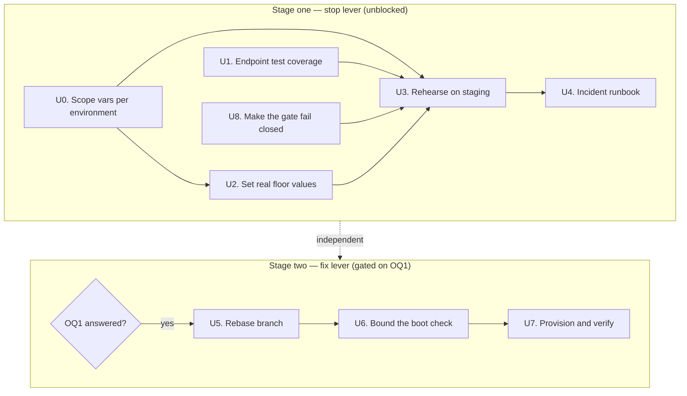

# Mobile Hotfix Delivery - Plan

## Status 2026-10-13

- **Stage one (FRA-333) is on `dev`.** U0 `60edcf285`, U1 `1851a429c`, U8 `0269031ea`, the App Store link `961e0dd47`, and U2 + U4 as the runbook `docs/runbooks/mobile-version-floor.md` (`d7665c1b2`). U3 was rehearsed on staging on 2026-10-08; the timings are in the runbook. This supersedes "Nothing has shipped yet" below.
- **Stage two (FRA-298) waits on CrabNebula's reply** to the 2026-10-08 email. U5 is done on `feat/fra-298-ota-updates`, not merged on purpose (it would ship the 2.0.8 startup hang). U6 failed on Android. U7 is not started. If CrabNebula ships a fix: rerun U6 on that version unmodified, then U7. If not: switch to `tauri-plugin-hotswap` (see the amendment), which needs its own design.

## Amendment 2026-10-07

- **Split.** Stage one (U0, U1, U8, U2, U3, U4) is now FRA-333 and ships first. FRA-298 covers stage two (U5–U7) only.
- **Nothing has shipped yet.** As of `origin/dev` on 2026-10-07: no `version.test.ts`, the gate still reads only `native.data`, `deploy.yml` has no `environment:` key, the repo has 0 environments, and there's no `docs/runbooks/`. `dev` is 572 commits ahead of `ba0453c5a`, and the app is at `1.0.105`.
- **OQ2 answered.** CrabNebula Cloud has been free since 19 June. Fair use: a release with no downloads for 90 days is deleted, but the latest release on each channel is protected, which our per-version channels always are. No fixed rate limit; they contact us before throttling. **Decision: host on Cloud.** `Config.cdn_host` (`src/lib.rs:396`, default `cdn.crabnebula.app`) is how we'd move to our own server later.
- **Licence (missed by the original plan).** The crate is `PolyForm-Noncommercial-1.0.0`. CrabNebula (Cristián, by email to Rodolphe) confirmed commercial use is OK, subject to the fair-use rules above. The reply doesn't cover shipping a modified copy, so the U6 `[patch]`/fork options need their explicit OK first.
- **OQ1 resolved: use the plugin unmodified, and measure before shipping.** Rodolphe doesn't want to patch the plugin or write our own (ADR-0001). There's still no release after 2.0.8, and registering the plugin later isn't possible: the asset loader's startup step reads `app.state::<OTAUpdater>()` (`:320`), which panics if the plugin isn't registered. **Correction to U6 step 3 and KTD4:** the startup check always uses the `"unset"` channel from `tauri.conf.json`, and `set_channel` (`:453`) only changes the channel in memory. So at startup it's one 404 request and never a download; the real per-version check and download run in the async JS path (`otaUpdater.ts`). Reconciliation also happens on that JS check. **U6 becomes a go/no-go measurement:** on iOS and Android, use network shaping (100% loss, very bad network, captive portal) and compare launch time with and without the plugin. If a stalled network can push launch past the iOS watchdog, FRA-298 doesn't ship and waits for a vendor fix. Invariant: nothing is ever published to `unset` or the default `over-the-air` channel.
- **Correction to KTD9 and U4 step 1.** `isBelow` is strict (`current < floor`), so a floor set *to* the bad version does not block it. To block bad version X, set the floor to the version that fixes it (the first version above X). If that version isn't live in the store yet, blocked users have no way out until it is.
- **Gate coverage of shipped builds.** The gate first shipped in `app-1.0.34` (2026-05-06). No floor can block a build at or below 1.0.33. Builds from 1.0.34 to 1.0.106 are blocked only while the store lookup succeeds; U8 removes that dependency from the next release onward.
- **If U6 fails, adopt `tauri-plugin-hotswap` (decided 2026-10-07).** This replaces "wait for a vendor fix". The plugin is MIT/Apache and does no network work in `setup()`; the check starts from JS with 15s timeouts, and a bundle that never calls `notifyReady()` is rolled back. It costs a small backend endpoint (`binary_version` in, manifest with `min_binary_version` out) and depends on a single maintainer of a 0.0.x crate. U6 must also run on Android: the `tauri-plugin-hot-update` README reports an indefinite TLS hang with `rustls-platform-verifier` inside Tauri plugins, and the CrabNebula crate's `reqwest` gets its TLS setup from our app's other dependencies.
- **Incident rule for raising the floor (decided 2026-10-07, goes into U4).** By default, raise the floor only once the fixed version is live in the store. When funds are at risk, raise it right away, even if blocked users have nothing to update to until the fix is approved.
- **U6 result (2026-10-08): fail on Android.** When the CDN accepts the connection and never answers, the startup check never ends: white screen for 147 s+ on a Pixel 7 Pro, no ANR. Fast failures (refused, airplane mode) cost nothing. iOS wasn't measured (the local Xcode 27 device build doesn't link). Rodolphe emailed CrabNebula the same day asking for a connect/read timeout or a way to skip the startup check, without asking to patch it ourselves. Next: if they ship a fix, rerun U6 on the new version unmodified; otherwise switch to `tauri-plugin-hotswap` with static manifests on our own bucket (no backend endpoint).
- **U5.** Decided: cut a new branch from `dev` and rebase Quentin's commits onto it. His branch stays untouched.

## Goal Capsule

- **Objective:** Give the mobile wallet a rehearsed *stop* lever that blocks a dangerous released version in about five minutes, and prepare a *fix* lever that delivers frontend-only corrections to installed binaries without waiting 1–3 days for App Store review.
- **Product authority:** The originating dialogue, grounded against `dev` at `9166f66fa`. Repo claims were independently verified, and `tauri-plugin-ota-updater` 2.0.8 boot behaviour was read from crate source fetched from crates.io.
- **Execution profile:** Two stages. Stage one (U0, U1, U8, U2, U3, U4 — in that dependency order) is independent, unblocked, and ships on its own. Stage two (U5–U7) is **gated** — do not start it until OQ1 is answered.
- **Open blockers:** Stage two only. OQ1 (how the boot-path check is bounded) and OQ2 (CrabNebula Cloud account and cost) both block U5–U7. Stage one has none.
- **Stop conditions:** Stop and ask before setting any non-zero production floor — it locks out every user below it immediately, and on iOS their recovery may itself be days from review. Stop and ask before dispatching `deploy.yml` on `main` for any floor change during stage one. Stop and ask before registering the OTA plugin in a shipped build while OQ1 is unanswered.
- **Tail ownership:** The implementer runs the Verification Contract gates. Stage one's runbook (U4) is a committed artifact, not a scratch note.

---

## Product Contract

### Summary

Set the hard-update floor to real values, document the five-minute procedure that raises it, and cover the currently untested endpoint that serves it. Then rebase the CrabNebula OTA branch and resolve its unbounded boot-path network call before it ships.

### Problem Frame

The wallet is live on both stores. Frontend fixes reach installed users only through a store release, and iOS review runs 1–3 days. The release pipeline is not the bottleneck — CI takes about 14 minutes (`1.0.99`: dispatch 16:06:04Z, release complete 16:24:36Z), and 15 versions shipped between 2026-07-10 and 2026-09-07. The wait is Apple's.

**The stop lever exists but has never been armed.** `services/backend/src/api/common/version.ts` publishes a per-platform `minVersion`, and `apps/wallet/app/module/version/component/HardUpdateGate` blocks the user behind a non-dismissible screen whose only action opens the store. No `MIN_VERSION_IOS` or `MIN_VERSION_ANDROID` repository variable is set, so both fall back to `"0.0.0"` — the value `version.ts:12` documents as "no hard-update enforced". The gate has never fired in production, the endpoint has no test, and no one has rehearsed raising a floor.

**Nothing can correct a released version.** 40 frontend fixes landed in `apps/wallet/app` and `packages/wallet-shared/src` since 2026-07-01, overwhelmingly UI corrections — tab-bar icons shifting on iOS, a hero rendering at twice its height, share copy in the wrong language. Roughly four harden integrity boundaries. None was wallet-unusable or funds-at-risk. The demonstrated need is tail risk, not routine delivery.

A colleague built the fix channel on `origin/feat/wallet-crabnebula-ota` (`ba0453c5a`, 2026-08-14). It is complete and its design is sound, but it registers a plugin whose `setup()` performs an unbounded blocking network request on the thread that builds the app, on every cold start.

### Requirements

**Stage one — the stop lever**

- R1. Each environment's floor value is deliberate and its reasoning is recorded, so `0.0.0` never means "nobody checked". A standing production floor gates nobody; raising it is an incident action.
- R2. An operator can raise the floor for one platform without affecting the other.
- R3. A committed runbook names who may raise a floor, what evidence justifies it, the exact procedure, and how it is lowered again.
- R4. The endpoint that serves the floor has automated coverage proving it reports configured values and the disabled default.
- R11. The gate decides using the running build's own version, not a value obtained from a third-party network call, so a failed or slow store lookup cannot let a below-floor client through.

**Stage two — the fix lever**

- R5. A frontend-only fix reaches an already-released, already-installed version without a store submission.
- R6. A published bundle only ever reaches the binary it was built against — same platform, same stage, same version.
- R7. Registering the OTA plugin adds no unbounded blocking work to cold start.
- R8. A build with no published bundle performs at most one cheap startup probe, and a slow or failed probe never delays launch.
- R9. Publishing requires a deliberate, auditable action naming the version being patched.
- R10. A bundle containing changes compiled into the installed binary cannot be published.

### Key Flows

- F1. **Blocking a dangerous version.** **Trigger:** a released version is found to risk users or funds. The operator sets the platform's repository variable above the bad version and dispatches the deploy workflow. Clients observe the new floor within one refresh cycle; those below it are blocked behind the existing gate, whether or not the device can reach the app store. The variable is reverted once a fixed version is live. **Covers R1, R2, R3, R11.**

- F2. **Correcting a broken version.** **Trigger:** a released version has a frontend defect not severe enough to block. A branch is cut from the release tag, the fix applied, the publish workflow dispatched naming that version. Clients on that exact version pick up corrected assets on their next cold start. **Covers R5, R6, R9, R10.**

- F3. **The ordinary launch.** **Trigger:** any cold start — the overwhelmingly common case. The app starts without waiting on an update check. The OTA capability is unobservable to a user whose version has no published bundle. **Covers R7, R8.**

### Acceptance Examples

- AE1. **Covers R1, R2.** An iOS floor is raised above a live version; iOS clients below it are gated, and Android clients on the same version are unaffected.
- AE1a. **Covers R11.** The device cannot reach the iTunes Lookup API — offline, rate-limited, or past the plugin's 4s timeout — and the installed version is below the floor. The client is still gated.
- AE2. **Covers R4.** With both env vars unset, the endpoint reports `0.0.0` for both platforms and the client does not gate.
- AE3. **Covers R6.** A bundle built for iOS at version X is published; an Android client at X and an iOS client at Y both ignore it.
- AE4. **Covers R8.** The device is offline or the update endpoint hangs. The app still reaches an interactive state, no slower than a build without the OTA capability.
- AE5. **Covers R10.** A branch containing a change under `apps/wallet/src-tauri/` is submitted for publication; publication is refused and names the offending file.
- AE6. **Covers R5, R9.** A fix is published against a released version; a client on that version receives it on next cold start with no store interaction, and the publication is attributable to an actor and a version afterward.

### Scope Boundaries

**Deferred for later**

- Routine feature delivery over OTA. The channel is for corrections; shipping features this way puts untested asset combinations in front of users and routes around review as a habit.
- Automating store promotion from the `internal` / `draft` upload.
- OTA for the web wallet, which deploys continuously and has no review latency to bypass.
- Staged or percentage rollouts of a published bundle.

**Outside this work**

- Changing the hard-update gate's appearance or behaviour once triggered. It is built and works; this plan arms it.
- Changing the mobile release workflow's build, signing, or upload behaviour.
- Building runtime-mutable configuration. See KTD1.

### Outstanding Questions

**Resolve before stage two (blocking U5–U7)**

- OQ1. How is the plugin's boot-path check bounded? It is unconditional in 2.0.8 (`src/lib.rs:555`) with no client timeout (`:99`) and no config option to disable it. The upstream repo `crabnebula-dev/tauri-plugin-ota-updater` is private, so a patch PR is not available — this needs a vendor request or a local fork. Any remedy must preserve the stale-manifest reconciliation at `:154-167` (see KTD4). Owner action: ask CrabNebula for a timeout or opt-out, and confirm whether they consider the discarded boot result intentional.
- OQ2. What does CrabNebula Cloud cost, and is that accepted for a capability expected to sit idle? No account is provisioned.

**Deferred to implementation**

- The exact floor values for R1. They depend on which versions are live in each store at implementation time, read from App Store Connect and Play Console.

### Sources / Research

- `services/backend/src/api/common/version.ts` — the endpoint; `:19-22` module-load capture, `:44-46` edge cache headers.
- `apps/wallet/app/module/version/hook/useVersionGate.ts:28,34-48` — client query config; `:141-149` the hard-gate condition, including the `!== "0.0.0"` guard.
- `apps/wallet/app/routes/__root.tsx:52` — where `VersionGate` mounts.
- `.github/workflows/deploy.yml:4-10` (`workflow_dispatch` + `force_deploy`), `:167-183` (the deploy step and the comment documenting the variable-plus-re-run design).
- `infra/gcp/secrets.ts:165-166` → `infra/gcp/backend.ts:14-20,84-88` — the value path into the pod.
- `.github/workflows/tauri-mobile-release.yml:443-457` (the TestFlight step; the `altool` call passes no submit-for-review flag), `:647-648` (`tracks: internal`, `status: draft`).
- `tauri-plugin-ota-updater` 2.0.8 crate source: `src/lib.rs:555` blocking check, `:99-104` no timeout, `:27` `DEFAULT_CHANNEL`, `:106-109` 404 handling, `:126-200` download and verification on the blocking path, `:154-167` stale-manifest reconciliation, `:318-363` `OTAAssets::setup` asset resolution.
- Vendor docs: https://docs.crabnebula.dev/plugins/over-the-air-updates/
- Branch under adoption: `origin/feat/wallet-crabnebula-ota` (`ba0453c5a`).

---

## Planning Contract

**Product Contract preservation:** changed. The original R1 (dynamic floor without pod restart) was dropped and the remaining stage-one requirements reshaped into R1–R4. Deploy durations sample at 3–6 minutes across recent **push-triggered** runs; `force_deploy: true` ORs into every gated step, so a forced dispatch additionally runs the SDK build plus the Apps and Example deploys and has not been timed. Only one `workflow_dispatch` run exists in the last 100, on a docs branch, so the forced path is unmeasured — U3 produces the real number. KTD1 rests on the structural argument (a config table would be the codebase's first runtime-mutable config) rather than on the exact minutes saved. R11 and AE1a were **added**: the gate fails open when the native version lookup fails, so arming the floor without R11 would ship a lever that does not hold under incident network conditions. R1 was **rewritten** after research established that the iOS installed-version distribution is unavailable from App Store Connect, which makes a standing non-zero production floor unjustifiable — see KTD9. Both are product-scope changes, not restructures.

### Key Technical Decisions

- KTD1. **No runtime-mutable configuration is built; the floor stays an environment variable set through a workflow dispatch.** (session-settled: user-directed — chosen over a config table with an admin endpoint: the existing path already takes ~5 minutes, and the alternative would be the backend's first request-time-mutable config — a new domain, table, migration, cache, and authenticated mutation surface — to save about four.) Governs R1, R2, R3.
- KTD2. **The floor is stored as GitHub repository variables, not secrets.** They are not sensitive, and `deploy.yml:182-183` already reads them with `0.0.0` fallbacks. Secrets would obscure the current value from anyone auditing the incident. Governs R1.
- KTD3. **The endpoint keeps module-load capture and its existing cache headers.** With KTD1 the value cannot change without a pod restart, so per-request reads would add cost with no benefit. The 60s edge cache and 5-minute client `staleTime` stay as they are. Governs R4.
- KTD4. **Any boot-check remedy must preserve stale-manifest reconciliation.** The discarded boot call is not pure waste: at crate `src/lib.rs:154-167`, when the server's bundle is older than the running build, it rewrites the on-disk manifest so later requests use the right version. Deleting the call outright would leave that state stale after a store build supersedes an OTA bundle. Applying a staged update does not depend on it — `OTAAssets::setup` independently re-checks staleness (`:327`) and loads staged assets from the cache (`:333`). Governs R7, R8.
- KTD5. **The channel string stays `{stage}-{platform}-{version}` and is computed once in the build.** It is what makes R6 structural rather than procedural: a bundle cannot reach a binary whose channel differs. The branch computes it from `walletPackage.version`, not `appVersion`, because the latter collapses to `COMMIT_HASH` on web deploys. Governs R6.
- KTD6. **No OTA baseline is published at release.** An empty channel makes the boot probe a cheap 404 (`src/lib.rs:106-109`). Publishing assets identical to the embedded ones would make every fresh install download the whole archive on first launch. Governs R8.
- KTD7. **The gate reads the build's own version constant, falling back to the native plugin's value only when it is absent.** `useVersionGate.ts:132` currently sources `currentVersion` solely from `native.data`, which on iOS comes from an iTunes Lookup call with a 4s timeout (`nativeUpdater.ts`, `FrakUpdaterPlugin.swift:48`). On failure the plugin returns `currentVersion: ""`, and the truthiness guard at `:136` makes the whole gate condition false — the client is not blocked. That couples the stop lever to Apple's availability at exactly the moment it matters. `process.env.APP_VERSION` is baked into the build by `apps/wallet/vite.defines.ts` and needs no network. Governs R11.
- KTD8. **The floor variables are scoped per GitHub environment, not repository-wide.** The repository has zero environments configured, so `vars.MIN_VERSION_IOS` is one value that both `gcp-staging` and `gcp-production` read. A staging rehearsal would therefore write the production floor, taking effect on the next push to `main` — arming production as a side effect of a test. The deploy job needs an `environment:` key selected by ref, mirroring the stage selection at `deploy.yml:170-174`. Governs R2.
- KTD9. **During an incident the floor is set to the bad version, not to a guessed safe baseline.** Setting it to "the oldest version the store still serves" is not computable here: tags show real gaps (`app-1.0.73`, `.75`, `.95`, `.97` never shipped), promotion is manual, and the repo does not record what each store actually serves. Setting it to the known-bad version blocks exactly that build and below, which is the intent, and needs no distribution data. It also keeps the standing production value at `0.0.0` — a floor that gates nobody until someone deliberately raises it. Governs R1.

### High-Level Technical Design

The two stages are independent. Stage one ships alone; stage two is gated behind OQ1.



The stop lever's actuation path, end to end:

```
operator sets the environment's MIN_VERSION_IOS = "1.0.98"
  → dispatch deploy.yml on the stage's ref, force_deploy: true   (~3-6 min *)
  → K8s Secret rewritten, backend pods roll
  → GET /common/version reports the new floor
  → edge cache expires                                           (<= 60 s)
  → client refetches on next foreground or cold start            (UNBOUNDED)
  → isBelow(build version, floor) → HardUpdateGate blocks
```

**The last hop has no upper bound.** `useVersionGate.ts:34-48` sets `staleTime` and `refetchOnWindowFocus` but no `refetchInterval`. In TanStack Query, `staleTime` marks data stale; it does not schedule a refetch. The sibling native query at `:78-90` adds an explicit `refetchInterval` for the case that needs polling, which confirms the distinction is deliberate. So an app sitting backgrounded is never re-fetched: coverage arrives on the user's next foreground or relaunch, which can be hours or days.

A foregrounded user is blocked within roughly 5–7 minutes. Universal coverage has no deadline. An on-call responder must not read a slow tail as the lever having failed — U4 records both figures separately for exactly this reason.

\* The 3–6 minute figure is sampled from recent **push-triggered** runs. `force_deploy: true` ORs into every gated step (`deploy.yml:92,96,101,116,131,139,146,158,168,186,197`), so a forced dispatch also runs the SDK build plus the Apps and Example deploys — a superset of what was timed, and expected to be slower. It has not been measured; U3 produces the real number.

### Assumptions

- iOS review latency of 1–3 days is the operative figure. Stated in dialogue, not measured from App Store Connect records. If review is routinely same-day, stage two's value drops sharply and OQ2 should be reconsidered before paying.
- The floor comparison is dotted-numeric, not semver-range. `apps/wallet/app/module/version/utils/compareVersions.ts` parses integer components and treats non-numeric as `0`, so a prerelease suffix would not compare as expected. Floor values must be plain `X.Y.Z`.
- The plugin's boot check remains unconditional in future 2.x releases. Confirmed for 2.0.8 only. 2.0.8 is current (published 2026-03-30) and its changelog entry reads "avoid blocking calls on async tasks", so the vendor is aware of the general concern.

---

## Implementation Units

### U1. Cover the version endpoint

- **Goal:** `GET /common/version` has automated coverage proving it reports configured floors and the disabled default.
- **Requirements:** R4 · KTD3
- **Dependencies:** none
- **Files:**
  - `services/backend/src/api/common/version.ts` — modify, extract floor resolution to an exported pure function
  - `services/backend/test/api/common/version.test.ts` — create
- **Approach:**
  1. Follow the shape of `services/backend/test/api/common/common.test.ts`: import the route directly, call `versionRoutes.handle(new Request(...))`, assert status and parsed JSON.
  2. Do **not** use `vi.resetModules()` to vary the env per test. `services/backend/test/infrastructure/external/jwt.installTicket.test.ts:6-9` documents why: it forces a second load of the `@backend-utils` barrel, re-registering prom-client counters against a registry that survives cache resets and throws on double registration.
  3. Set `process.env.MIN_VERSION_IOS` / `MIN_VERSION_ANDROID` in a `vi.hoisted()` block so they are in place before the route module is imported once. That gives one env permutation per test *file*. Cover the remaining permutations by extracting the floor resolution into a small exported pure function in `version.ts` and testing it directly — the module-load capture then reduces to one line calling a function that is fully covered.
  4. Keep the endpoint's behaviour unchanged. This is a testability refactor, not a behaviour change; KTD3 still holds and the response shape and cache headers stay as they are.
  5. Import `../../mock/common` for the shared infrastructure mocks, as the sibling tests do.
  6. Assert the cache-control header alongside the body — it is part of the contract that keeps the actuation path fast and is currently unprotected.
- **Execution note:** Step 3's split is what makes this unit testable at all. Confirm the prom-client constraint holds before designing around it — if `services/backend/vitest.config.ts` isolates per-file environments, a simpler approach may work.
- **Patterns to follow:** `services/backend/test/api/common/common.test.ts` for route invocation and assertion style; `services/backend/test/infrastructure/external/jwt.installTicket.test.ts:1-10` for the documented module-reload constraint.
- **Test scenarios:**
  - Covers AE2. With both env vars unset, the response body reports `0.0.0` for `ios` and `android`.
  - With `MIN_VERSION_IOS` set to `1.0.98` and Android unset, the response reports `1.0.98` for iOS and `0.0.0` for Android.
  - With both set to different values, each platform reports its own — proving the two are independent and not cross-wired.
  - The response carries `cache-control: public, max-age=60, s-maxage=60, stale-while-revalidate=300`.
  - The response shape matches the declared schema: `minVersion` is an object with exactly `ios` and `android` string keys.
- **Verification:** `bun run --cwd services/backend test` passes, including the new file.

### U8. Make the gate fail closed

- **Goal:** The hard gate blocks a below-floor client even when the native version lookup fails.
- **Requirements:** R11 · KTD7
- **Dependencies:** none. Must land before U3, because U3's rehearsal is only meaningful against a gate that holds.
- **Files:**
  - `apps/wallet/app/module/version/hook/useVersionGate.ts` — modify
  - `apps/wallet/app/module/version/hook/useVersionGate.test.ts` — modify
- **Approach:**
  1. At `:132`, source `currentVersion` from `process.env.APP_VERSION` first, falling back to `native.data?.currentVersion` and then `""`. The build constant is baked by `apps/wallet/vite.defines.ts` and is available with no network call.
  2. Leave the truthiness guard at `:136` in place. It still protects the case where neither source has a value, which should now be unreachable in a real build but is reachable in tests.
  3. Change nothing about the soft-update branches at `:148-159`. They legitimately depend on native data — a store version cannot be known without asking the store — and coupling them to the build constant would break the soft prompt.
  4. Keep a dotted-numeric guard on the build constant before using it. `vite.defines.ts:52` resolves `appVersion` to `process.env.COMMIT_HASH ?? walletPackage.version`, and a commit hash parsed by `compareVersions` yields `0` — below every floor. Verified that only `deploy.yml:158` sets `COMMIT_HASH`, and `tauri-mobile-release.yml` does not, so mobile builds already carry the dotted version. The guard defends the invariant rather than fixing a present bug: if a future workflow change sets `COMMIT_HASH` for a mobile build, the gate would otherwise lock out every user instead of none.
- **Execution note:** The gate currently fails open, so a rehearsal against the unfixed gate proves nothing. Land this before U3. The `VersionGate` mounts Tauri-only (`apps/wallet/app/routes/__root.tsx:52`), so the web wallet is unaffected either way.
- **Patterns to follow:** the existing `vi.hoisted` mock block in `useVersionGate.test.ts` for platform flags and the backend response.
- **Test scenarios:**
  - Covers AE1a. Native check resolves with `currentVersion: ""` (its failure shape) while the build version is below the floor — the hook returns `hard_update`.
  - Native check rejects outright while the build version is below the floor — the hook still returns `hard_update`.
  - Native check succeeds and reports a version differing from the build constant — the build constant wins.
  - Build version is at or above the floor with a failing native check — the hook does not gate.
  - Floor is `0.0.0` with a below-floor build version — the hook does not gate, preserving the disabled-means-disabled contract.
  - `APP_VERSION` is a commit hash rather than a dotted version — the hook does not gate on it, and falls back to the native value.
  - The soft-update branches still fire from native data when no hard gate applies, proving step 3 left them intact.
- **Verification:** `bun run --cwd apps/wallet test` passes. On a device with the network disabled and a floor set above the installed version, the gate renders.

### U0. Scope the floor variables per environment

- **Goal:** Staging and production carry independent floor values, so a staging rehearsal cannot arm production.
- **Requirements:** R2 · KTD2, KTD8
- **Dependencies:** none. Blocks U2 and U3.
- **Files:**
  - `.github/workflows/deploy.yml` — modify
- **Approach:**
  1. Create two GitHub environments, one per deploy stage. The repository has **zero** environments today (`gh api repos/:owner/:repo/environments` returns `total_count: 0`), so `vars.MIN_VERSION_IOS` is a single repository-wide value that both `gcp-staging` and `gcp-production` read.
  2. Add an `environment:` key to the deploy job, selected by ref the same way the stage already is at `deploy.yml:170-174`. Without it the job cannot see environment-scoped variables.
  3. Move `MIN_VERSION_IOS` and `MIN_VERSION_ANDROID` from repository variables to environment variables in both environments. Keep the `|| '0.0.0'` fallbacks at `:182-183` — they now mean "this environment has no floor set", which stays the correct default.
  4. Do not add required reviewers or deployment branch rules to the environments. That would change who can deploy, which is outside this plan's scope and would slow the incident path this work exists to protect.
  5. Update the `deploy.yml:177-180` comment to say the variables are environment-scoped, since it currently describes them as repository settings.
- **Execution note:** Verify by dispatching a staging deploy with a distinguishing staging-only value and confirming the production endpoint still reports its own. The shared-variable defect is invisible until two values diverge.
- **Test scenarios:** Test expectation: none — workflow configuration. Correctness is proved by the divergence check in the execution note and by U3's rehearsal leaving production unchanged.
- **Verification:** Setting a floor in the staging environment changes `backend-dev.gcp-dev.frak.id/common/version` and leaves `backend.frak.id/common/version` untouched.

### U2. Establish the floor policy

- **Goal:** Production carries a floor value that gates nobody today, and the conditions for raising it are written down rather than guessed at during an incident.
- **Requirements:** R1, R2 · KTD1, KTD2, KTD8, KTD9
- **Dependencies:** U0
- **Files:** none in-repo — environment settings plus the U4 runbook entry recording the reasoning.
- **Approach:**
  1. On **Android**, read the installed-version distribution in Play Console (Statistics, App version dimension). If a version exists that essentially no active install sits below, it may be set as a standing floor.
  2. On **iOS**, do not attempt this. App Store Connect reports active devices by OS version and device model, not by installed app version — the distribution the decision needs is not available. Leave the production iOS floor at `0.0.0`.
  3. Set the **staging** environment to a real non-zero value on both platforms. Staging has no dormant population to protect, and U3 needs a configured floor to rehearse against.
  4. Record in the U4 runbook why each production value is what it is — including that iOS is `0.0.0` because the data does not exist, not because nobody checked. That is what discharges R1's intent: the value is explained, not merely present.
  5. Dispatch `deploy.yml` on the **`main` ref** for production and the **`dev` ref** for staging, with `force_deploy: true`. The stage is chosen by ref at `:170-174`, and the repository default branch is `main`, so the dispatch UI defaults to production.
  6. Confirm via each environment's deployed endpoint that the expected values are reported.
- **Execution note:** A standing non-zero production floor is a liability, not a safety feature — it can only gate users, never protect them, until an incident makes gating desirable. The lever's value comes from U0, U3, and U4, which make it fast and rehearsed. Setting a number now buys nothing.
- **Test scenarios:** Test expectation: none — no code changes. Correctness is proved by U3's staging rehearsal and the per-environment endpoint check in step 6.
- **Verification:** Staging reports its configured non-zero values; production reports the values chosen per steps 1–2, and no production user is gated.

### U3. Rehearse the stop lever on staging

- **Goal:** The blocking path is proven end to end on `gcp-staging` before anyone needs it in production.
- **Requirements:** R1, R2, R11 · KTD1, KTD7, KTD8
- **Dependencies:** U0, U1, U2, U8
- **Files:** none in-repo — the observations feed U4.
- **Approach:**
  1. Set `MIN_VERSION_IOS` in the **staging environment** above the version installed on a test device, then dispatch `deploy.yml` on the **`dev` ref**. The ref decides the stage (`:170-174`) and the repository default branch is `main`, so the dispatch UI offers production first — selecting it here would arm production instead of rehearsing.
  2. Time each hop, and measure the foregrounded and backgrounded cases **separately**: workflow duration, time until the endpoint reports the new value, then time-to-block for (a) an app in the foreground and (b) an app backgrounded before the change. Case (b) has no upper bound by design — record what it actually took and what triggered it.
  3. Confirm the gate renders, that its store button opens the correct store listing, and that there is no dismissal path.
  4. Confirm the Android client on the same version is unaffected, proving per-platform independence.
  5. Repeat step 3 with the device's network disabled after the floor has propagated, proving U8's fix holds where the unfixed gate would have failed open.
  6. Revert the variable, redeploy, and confirm the gate clears.
- **Execution note:** Measure rather than assume. The design section's figures are derived from configuration, not observation; this unit replaces them with real numbers. Before starting, confirm U0 landed — without per-environment scoping this rehearsal writes the production floor.
- **Test scenarios:** Test expectation: none as automated coverage — this is a manual rehearsal against deployed infrastructure. It is nonetheless the only proof of AE1: steps 1–3 establish that a device below the floor is blocked, and step 4 that the other platform is unaffected. Its output is the measured timing and confirmed gate behaviour recorded in U4.
- **Verification:** A test device below the floor is blocked and cannot dismiss; a device on the other platform is unaffected; reverting clears the gate. Timings are recorded.

### U4. Write the incident runbook

- **Goal:** An on-call engineer can raise and lower a floor correctly without reconstructing the mechanism.
- **Requirements:** R3 · KTD1, KTD2, KTD8
- **Dependencies:** U3
- **Files:**
  - `docs/runbooks/mobile-version-floor.md` — create
- **Approach:**
  1. State the decision criteria first: what severity justifies blocking. Per KTD9 the floor is set to the **known-bad version**, which blocks exactly that build and below — not to a guessed safe baseline. Blocking is heavier than it looks: users cannot reach the wallet at all until they update, and on iOS the fixed build may itself be days from review.
  2. Give the exact procedure: which environment's variable, what value format (plain `X.Y.Z` per the Assumptions), which ref to dispatch `deploy.yml` on for that environment, `force_deploy: true`, and how to confirm the endpoint reports the new value.
  3. Record both measured timings from U3 — foreground and background. State plainly that there is no deadline for universal coverage: a backgrounded app is not re-fetched until it next foregrounds. A responder who expects everyone gated within minutes will wrongly conclude the lever failed and escalate to a second, riskier action.
  4. Give the rollback: revert the variable, redeploy on the same ref, confirm cleared.
  5. Name the traps explicitly — a variable change alone does nothing without a workflow re-run; the dispatch ref decides the stage and defaults to `main`, so a production dispatch is one wrong click away; `kubectl set env` is reverted by the next deploy (`deploy.yml:179-180`); `0.0.0` means disabled; the two platforms are independent; the iOS installed-version distribution is not available from App Store Connect, so never guess a baseline floor for it.
  6. State what the floor cannot do: it blocks, it does not fix. Cross-reference stage two.
- **Patterns to follow:** Check `docs/` for an existing runbook convention and match it. If none exists, keep the structure flat — criteria, procedure, rollback, traps.
- **Test scenarios:** Test expectation: none — documentation. Correctness is that U3's rehearsal could be reproduced from the document alone.
- **Verification:** Someone who did not perform U3 can follow the document and describe the correct sequence, including the rollback.

### U5. Rebase the OTA branch

- **Goal:** `origin/feat/wallet-crabnebula-ota` sits cleanly on current `dev` with no behavioural change.
- **Requirements:** R5, R6, R9, R10 · KTD5, KTD6
- **Dependencies:** OQ1 must be answered first. Independent of U1–U4.
- **Files:** (from the branch, rebased)
  - `apps/wallet/app/module/version/utils/otaUpdater.ts` — create
  - `apps/wallet/app/module/version/utils/otaUpdater.test.ts` — create
  - `apps/wallet/app/module/version/hook/useOtaUpdate.ts` — create
  - `apps/wallet/app/module/version/hook/useOtaUpdate.test.ts` — create (not on the branch)
  - `apps/wallet/app/module/version/queryKeys/version.ts` — modify
  - `apps/wallet/app/module/version/component/VersionGate.tsx` — modify
  - `apps/wallet/vite.defines.ts` — modify
  - `apps/wallet/package.json`, `bun.lock` — modify
  - `apps/wallet/src-tauri/{Cargo.toml,Cargo.lock,tauri.conf.json,src/lib.rs,capabilities/default.json}` — modify
  - `.github/workflows/wallet-ota-hotfix.yml` — create
  - `apps/wallet/AGENTS.md` — modify
- **Approach:**
  1. Rebase onto `dev`. **Expect exactly one conflict, in `bun.lock`** — resolve it by regenerating with `bun install`, never by hand-merging. Verified with `git merge-tree --write-tree`: six files overlap between the branch and `dev` since the merge base, and five auto-merge (`apps/wallet/package.json`, `src-tauri/{Cargo.toml,Cargo.lock,tauri.conf.json,src/lib.rs}`). `lib.rs` merges cleanly because `dev`'s `0a2a687b1` adds `mod ios;` and a block inside `.setup()`, while the OTA diff touches the builder head and the `.run()` call.
  2. Do not alter the branch's channel construction — KTD5 depends on it, and the `walletPackage.version` choice is deliberate. Expect the channel to move from `*-1.0.93` to whatever `dev`'s current version is: the branch pins `1.0.93` and `dev` is ahead. That shift is correct and must not be undone; the channel tracks the binary it ships with.
  3. Add `useOtaUpdate.test.ts`, which the branch omits. The existing `otaUpdater.test.ts` covers the utility's six paths but nothing covers the hook's one-shot query configuration.
  4. Leave `channel: "unset"` in `tauri.conf.json` as-is per KTD6, and verify it survives the rebase — the crate's `DEFAULT_CHANNEL` is a real name (`src/lib.rs:27`), so losing that string would point every install at a live channel.
- **Execution note:** This unit is a faithful rebase, not a redesign. Behaviour changes belong in U6.
- **Test scenarios:**
  - The six existing `otaUpdater.test.ts` cases still pass unchanged after rebase.
  - Covers AE3. The hook returns `false` when `IS_TAURI` is false, without invoking the plugin.
  - The hook issues exactly one check per session — asserting the query does not refetch on remount, on window focus, or on reconnect.
  - The hook returns `true` only for a `staged` result, and `false` for `up_to_date` and `unsupported`.
  - A plugin rejection surfaces rather than being swallowed, and the hook returns `false` without retrying.
  - `__OTA_CHANNEL__` is `null` for a web build and `{stage}-{platform}-{version}` for iOS and Android builds.
- **Verification:** `bun run --cwd apps/wallet test` passes. `bun run typecheck` and `bun run lint` pass. The Tauri build compiles for both mobile targets.

### U6. Bound the boot-path check

- **Goal:** Cold start performs no unbounded blocking work, while stale-manifest reconciliation still happens.
- **Requirements:** R7, R8 · KTD4
- **Dependencies:** U5, and OQ1's answer determines the approach.
- **Files:** depends on OQ1's outcome — a `Cargo.toml` version bump if the vendor ships a timeout, or a patch/fork entry plus its source if not.
- **Approach:**
  1. Apply whichever remedy OQ1 established. The options, in descending preference: a vendor-supplied timeout or opt-out flag; a `[patch]` entry against a minimal local fork that wraps the `setup()` call; a fork that moves reconciliation off the blocking path entirely.
  2. Whichever path is taken, preserve the reconciliation at crate `src/lib.rs:154-167` per KTD4. If the check is deferred rather than bounded, it must still run — just not before the first webview load.
  3. Do not rely on `channel: "unset"` as the mitigation. It makes the common case cheap but leaves the unbounded call in place for any build that does have a channel, which is precisely the build a user is on during an incident.
  4. Record the chosen approach as a KTD amendment in this plan, including what a future plugin upgrade must re-check.
- **Execution note:** Prove this with a runtime measurement, not by reading the diff. Launch a build with the network blackholed and compare time-to-interactive against a build without the plugin.
- **Test scenarios:**
  - Covers AE4. With the device offline, the app reaches an interactive state; measured time-to-interactive is within noise of a build without the OTA plugin.
  - With the update endpoint artificially delayed beyond the chosen bound, the app still launches and the check abandons.
  - After a store build supersedes a previously-staged OTA bundle, the app serves embedded assets and the on-disk manifest no longer claims the stale version — proving reconciliation survived.
  - A previously staged bundle is still applied on the next cold start, proving the remedy did not break the apply path.
- **Verification:** Measured time-to-interactive on a blackholed network is within noise of a no-plugin build. Reconciliation and apply both still work on device.

### U7. Provision and verify the publish path

- **Goal:** A frontend fix can be published against one released version and reaches only that version's clients.
- **Requirements:** R5, R6, R9, R10 · KTD5, KTD6
- **Dependencies:** U6, and OQ2 must be answered.
- **Files:**
  - `.github/workflows/wallet-ota-hotfix.yml` — verify as rebased; adjust only if provisioning requires it
- **Approach:**
  1. Provision the CrabNebula Cloud account and application. Generate the signing keypair per the vendor's `generate-keypair` command.
  2. Add three repository secrets following the repo's existing naming conventions: the Cloud API key, the signing private key, and its password. Match the pattern used in `.github/workflows/tauri-mobile-release.yml` for multi-line key material.
  3. Confirm the public key in `tauri.conf.json` matches the generated private key. A mismatch fails signature verification at `src/lib.rs:142-144` and manifests as a silently ignored update rather than a clear error.
  4. Exercise the workflow's guard on a deliberately bad input before trusting it on a real one.
  5. Publish a cosmetic, reversible change against a staging version and verify delivery on a device.
- **Execution note:** Verify the guard rejects before verifying the happy path succeeds. A publish path that works but does not refuse native changes is more dangerous than one that does not work at all.
- **Test scenarios:**
  - Covers AE5. A branch with a change under `apps/wallet/src-tauri/` is submitted; the workflow fails and names the offending file.
  - A branch not descended from a release tag is submitted; the workflow fails and says to re-cut from the tag.
  - A branch whose `package.json` version has no corresponding `app-*` tag is submitted; the workflow fails.
  - Covers AE6. A cosmetic change is published against a staging version; a device on that exact version shows it after a cold start, and the publication is attributable to an actor and version in the Cloud dashboard.
  - Covers AE3. A device on a different version of the same platform does not receive it.
  - A device on the other platform at the same version does not receive it.
- **Verification:** The guard refuses all three bad inputs. A published staging bundle reaches only the matching platform-and-version and nothing else.

---

## Verification Contract

- `bun run format && bun run lint && bun run typecheck && bun run test` — the mandatory gate, all four, before any commit.
- `bun run --cwd services/backend test` — U1's endpoint coverage.
- `bun run --cwd apps/wallet test` — U5's client coverage.
- `bun run check:es-output` and `bun run check:ios-floor` — run for stage two, which touches `apps/wallet` build configuration and `src-tauri`.
- Device verification is required for U3, U6, and U7. None of these can be proved by the test suite: U3 exercises deployed infrastructure, U6 measures cold-start timing under network failure, U7 exercises a third-party delivery path.
- Stage one is complete and shippable without stage two. Do not treat stage two's gating as blocking stage one's merge.

---

## Definition of Done

**Stage one**

- The floor variables are scoped per GitHub environment, and a staging change provably does not alter the production endpoint.
- The version endpoint has test coverage for configured, partially-configured, and unset floors, plus its cache headers.
- The gate decides from the build's own version and blocks a below-floor client with the network unavailable.
- Each environment's floor value is deliberate and its reasoning is recorded in the runbook — including that production iOS stays `0.0.0` because the installed-version distribution does not exist, not because nobody checked.
- The blocking path has been rehearsed on staging — including the offline case — with per-platform independence confirmed and rollback proven.
- `docs/runbooks/mobile-version-floor.md` exists, carries both measured timings (foreground and background), states that universal coverage has no deadline, and names the traps.
- The full quality gate passes.

**Stage two** (additionally, and only once OQ1 and OQ2 are answered)

- The branch is rebased with the `bun.lock` conflict resolved by regeneration, no behavioural drift, and the hook has test coverage.
- Cold start performs no unbounded blocking work, proven by measurement on a blackholed network, and stale-manifest reconciliation still happens.
- The publish guard refuses native changes, non-tag-descended branches, and unknown versions.
- A bundle published against one version reaches only that platform-and-version.
- The chosen boot-check remedy is recorded as a KTD amendment, naming what a future plugin upgrade must re-verify.

**Both stages**

- No dead-end or experimental code remains in the diff. If a boot-check approach was tried and abandoned in U6, it is removed, not left behind a flag.
